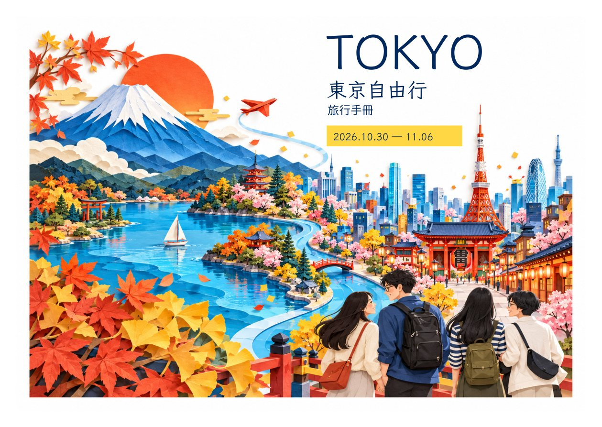

# 風格 C｜立體紙雕旅行世界

封面＋封底設計預覽，尚未改入手冊或印刷檔。

以鮮明秋色、立體紙層、富士山湖景及雷門街景組成連續旅行世界；四人以紙雕插畫風格融入畫面，不使用食物照片。保留白底留邊，適合後續 A4 不裁切版本。

左側封底、右側封面；點圖放大。

[風格 A・白框全景](../cover-whiteborder-preview/README.md)｜[風格 B・撞色拼貼](../cover-whiteborder-style-b/README.md)
