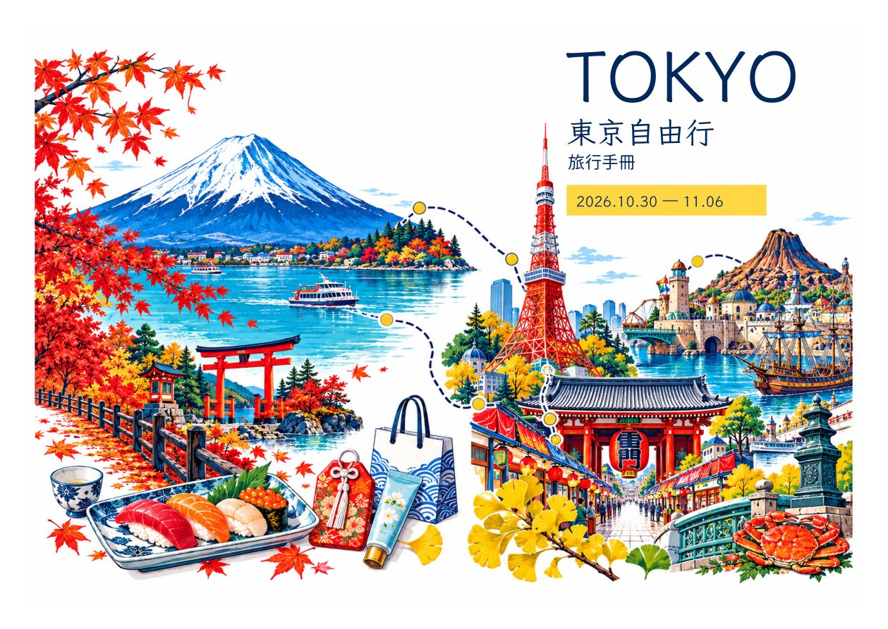

# 風格 D｜旅行路線插畫

封面＋封底設計預覽，尚未改入手冊或印刷檔。

不放人物，以淺草雷門、東京鐵塔、神社御守、富士山與河口湖、海洋港灣、築地壽司及採買等行程元素，串成活潑的旅行路線插畫。保留適合 A4 列印的白底留邊。

左側封底、右側封面；點圖放大。

[風格 A・白框全景](../cover-whiteborder-preview/README.md)｜[風格 B・撞色拼貼](../cover-whiteborder-style-b/README.md)
